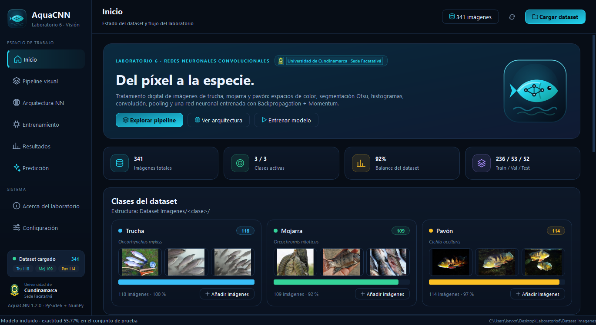
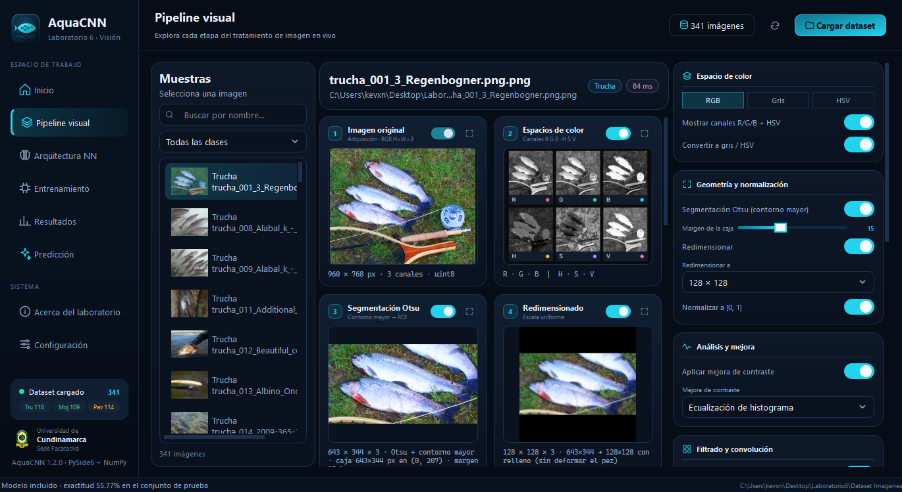
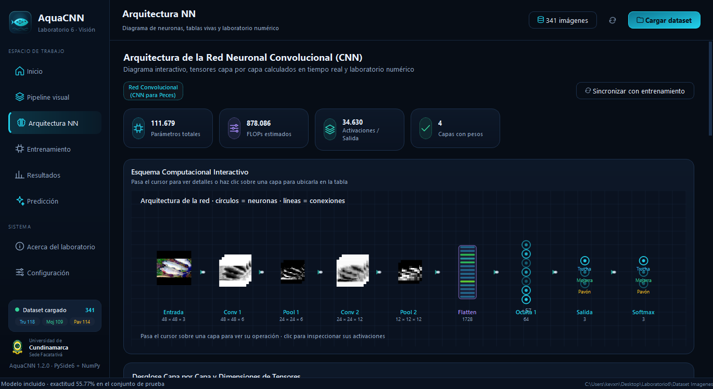
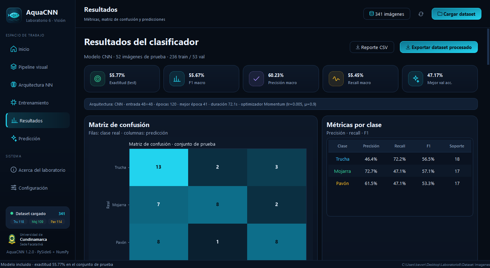
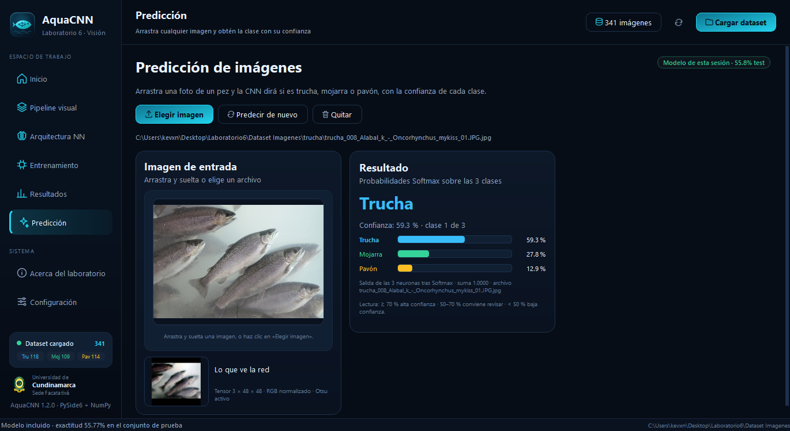

# AquaCNN · Laboratorio 6

**Tratamiento de imágenes para la clasificación de peces: trucha, mojarra y pavón.**

**Universidad de Cundinamarca** · **Sede Facatativá** · Facultad de Ingeniería

Autores:
- Kevin Santiago García Ospina
- Julián Andrés Pérez Mendigaño
- Iván Daniel Palacio Hernández
- Andrés Felipe Maldonado Forero

Aplicación de escritorio completa, interactiva y autocontenida que implementa, paso a paso, el
diagrama del **Laboratorio 6 — Introducción a las Redes Neuronales Convolucionales**:

> adquisición RGB → espacios de color → segmentación Otsu + redimensionado + normalización → histogramas y
> ecualización → convolución → pooling → flatten → red neuronal con **Backpropagation,
> Momentum y Softmax**.

Todo el procesamiento y la red neuronal están implementados **desde cero con NumPy**; no se usa
TensorFlow, PyTorch ni Keras. La interfaz está construida con **PySide6 (Qt 6)** y los cálculos
pesados se ejecutan en hilos (`QThread` / `QThreadPool`) para que la ventana nunca se congele.

---

## 1. Inicio rápido (Windows)

### Opción 0 — Descargar y ejecutar (sin instalar nada)

1. Descarga **`AquaCNN_Windows.zip`** desde la sección *Releases* del repositorio.
2. Descomprime el ZIP **completo** en una carpeta.
3. Haz doble clic en **`AquaCNN.exe`** (guía rápida incluida en `COMO_USAR.txt`).

No necesitas Python, ni pip, ni conexión a internet. El paquete incluye el dataset de
341 imágenes y un **modelo CNN ya entrenado** que se carga automáticamente al abrir la app.
La primera vez, el dataset y el modelo se copian a una carpeta escribible: junto al `.exe`
si la carpeta es editable o, si no lo es (por ejemplo `C:\Program Files`), en
`%LOCALAPPDATA%\AquaCNN`. La copia se hace en segundo plano, sin congelar la ventana.

> La aplicación no está firmada digitalmente. Si Windows SmartScreen muestra un aviso,
> pulsa **Más información → Ejecutar de todas formas**.

### Capturas

| Inicio | Pipeline visual |
|---|---|
|  |  |

| Arquitectura NN | Resultados |
|---|---|
|  |  |

**Predicción**



### Opción A — Lanzador de un solo clic (recomendado para desarrollo)

1. Instala **Python 3.10 o superior** (probado con 3.14). Marca *Add Python to PATH*.
2. Haz doble clic en **`Iniciar AquaCNN.bat`**.

El lanzador:

- crea el entorno virtual `.venv` si no existe,
- instala las dependencias de `requirements.txt` solo la primera vez,
- abre la aplicación sin consola.

### Opción B — Ejecutable nativo (para distribuir)

```powershell
.\build.ps1 -Clean -Zip
```

Se genera:

```
dist\AquaCNN\AquaCNN.exe        <- ejecutable (doble clic)
dist\AquaCNN_Windows.zip        <- carpeta lista para copiar a otro PC
```

> **Importante:** distribuye **la carpeta `dist\AquaCNN` completa**, no solo el `.exe`.
> El ejecutable ya incluye el dataset de ejemplo y el modelo preentrenado: en el primer
> arranque los copia a una carpeta escribible para que puedas modificarlos.

### Opción C — Manual

```powershell
python -m venv .venv
.\.venv\Scripts\activate
pip install -r requirements.txt
python app.py
```

---

## 2. Requisitos

| Elemento | Mínimo |
|---|---|
| Sistema | Windows 10/11 (64 bits) |
| Python (solo opción A/C) | 3.10 – 3.14 |
| RAM | 4 GB (8 GB recomendado) |
| Pantalla | 1024 × 620 (la UI es responsiva) |
| GPU | No necesaria (NumPy en CPU) |

Dependencias: `PySide6 6.12`, `numpy 2.5`, `opencv-python 5.0`, `matplotlib 3.11`, `openpyxl 3.1`.

---

## 3. Recorrido por la aplicación

### Inicio
- Tarjetas con el estado del dataset: total, clases activas, balance y división train/val/test.
- Miniaturas por clase y botones para **añadir imágenes** a cada carpeta.
- Configuración de la **división estratificada** (por defecto 70 / 15 / 15) y semilla aleatoria.
- Gráfico de distribución por clase.

### Pipeline visual
Vista multi-etapa de una imagen seleccionada. **Todos los controles recalculan en vivo**
(hilo de fondo + caché de la imagen original) y **cada etapa tiene su propio interruptor**:
al desactivarla, la imagen pasa sin cambios a la siguiente y la tarjeta se muestra atenuada con la
etiqueta `DESACTIVADA`.

1. **Imagen original** — RGB, dimensiones, canales, dtype.
2. **Espacios de color** — canales R, G, B y H, S, V.
3. **Segmentación Otsu** — umbral automático, limpieza morfológica, contorno más grande y caja
   envolvente con margen: localiza el pez y descarta el fondo.
4. **Redimensionado** — tamaño destino independiente (64–256 px), conservando la proporción con relleno.
5. **Conversión de color** — escala de grises, canal V de HSV o RGB completo (la CNN usa RGB).
6. **Mejora e histograma** — histograma de 256 bins y ecualización global del histograma por canal.
7. **Normalización** — `uint8 [0,255] → float32 [0,1]`.
8. **Convolución** — kernels 3×3: borde vertical/horizontal, Sobel X/Y, Laplaciano, enfoque,
   relieve o matriz personalizada; padding y stride visibles y editables.
9. **Activación ReLU** y **pooling** Max/Average con tamaño de ventana.
10. **Flatten** — vector de características y estadísticas.
11. **Entrada a la red** — tensor exacto que consume la CNN.

Puedes buscar imágenes, filtrar por clase y ampliar cualquier etapa a pantalla completa.

### Arquitectura NN
- **Diagrama de círculos y líneas**: una columna por capa, neuronas dibujadas como círculos,
  conexiones animadas, mapas de activación reales y etiquetas por clase. Los conteos cambian en
  vivo con los hiperparámetros de Entrenamiento.
- **Tabla viva** calculada desde el modelo real: etapa, operación, forma de entrada, kernel,
  stride, padding, filtros, forma de salida, elementos, parámetros, FLOPS y fórmula de la **CNN convolucional**.
- **Laboratorio numérico con pesos reales**: elige **Conv 1**, **Capa oculta** o **Salida Softmax**
  y recorre el cálculo de un filtro, una neurona o las tres probabilidades usando los pesos
  aprendidos del modelo cargado y una muestra real del dataset ya preprocesada.
- **Recorrido paso a paso**: muestra la ventana, los productos, la suma del sesgo, ReLU, los logits
  y la normalización Softmax, con controles de inicio, anterior, reproducir, siguiente y final.
- **Auditoría manual**: lista de comprobaciones del motor NumPy y verificación de gradientes por
  diferencias finitas contra el backpropagation implementado.

### Entrenamiento
- Clasificador **CNN** (Conv → ReLU → MaxPool → Conv → ReLU → MaxPool → Flatten → Capa oculta → Softmax).
- Hiperparámetros: épocas, batch, learning rate, momentum, weight decay, semilla, tamaño de entrada,
  neuronas ocultas, filtros por capa.
- Botón **Aplicar configuración recomendada** con el preset que mejor equilibró las tres clases:
  48×48, filtros 6/12, 64 ocultas, 120 épocas, lr 0.005, weight decay 3e-4, histograma, segmentación
  Otsu con margen, aumento y pesos por clase.
- Data augmentation, pesos por clase y segmentación Otsu opcionales.
- Gráficas en vivo de **pérdida** y **exactitud** (train/validación), chips de métricas, ETA,
  barra de progreso y registro detallado.
- Botones para detener, **guardar** y **cargar** el modelo (`.npz` con pesos, configuración e historial).
- **Modelo preentrenado incluido**: `Modelos entrenados/AquaCNN_cnn_peces.npz` se carga al abrir la
  app y se evalúa automáticamente sobre el conjunto de prueba, de modo que la página *Resultados*
  ya muestra métricas reales sin entrenar nada.
- El modelo incluido es una CNN pequeña entrenada en CPU con 341 imágenes RGB (3 canales).
  Su exactitud de prueba ronda el **56 %** (frente al 33 % del azar en tres clases): el dataset es
  difícil y deliberadamente pequeño. La aplicación está pensada para experimentar: añade imágenes,
  ajusta hiperparámetros y compara la matriz de confusión.

### Resultados
- Exactitud, F1 macro, precisión y recall macro, mejor exactitud de validación.
- **Matriz de confusión** del conjunto de prueba y tabla de métricas por clase.
- Galería de predicciones con filtros *Todas / Aciertos / Errores* y nivel de confianza.
- **Inspector de pesos y gradientes**: elige cualquier tensor (Conv/Oculta, W/b) y observa su mapa
  de calor, estadísticas (forma, mínimo, máximo, media, desviación, norma L2, porcentaje de ceros)
  y el gradiente ∂L/∂θ calculado por backpropagation.
- **Exportar reporte CSV** y **exportar el dataset procesado** por etapas.

### Predicción
- Sección independiente para **arrastrar y soltar cualquier imagen** (o elegirla con el explorador).
- Vista previa del archivo, del tensor RGB exacto que consume la CNN y de la segmentación aplicada.
- Resultado con la **clase predicha**, su **porcentaje de confianza** y las **tres probabilidades
  Softmax** en barras comparativas; aviso automático cuando la confianza es baja.
- Reutiliza el mismo preprocesado y el mismo modelo que la página de Resultados, sin duplicar lógica.

### Acerca del laboratorio
Objetivo, etapas implementadas, formulación matemática, stack tecnológico, créditos del dataset y
atajos de teclado.

### Configuración
Tema visual (Océano profundo, Abismo, Aurora, Bosque, Grafito), color de acento, **tipografía**
(familia y tamaño base), animaciones, tooltips, arranque maximizado, miniaturas por clase,
actualización automática del pipeline y ruta del dataset. Las preferencias se guardan con
`QSettings` y el tema o la fuente se aplican al reiniciar la interfaz.

Los términos técnicos (kernel, stride, padding, ReLU, pooling, softmax…) muestran un tooltip
breve al pasar el cursor sobre la palabra exacta; se oculta solo a los pocos segundos.

---

## 4. Exportación del dataset procesado

La exportación crea una carpeta con esta estructura:

```
Dataset_procesado_AAAAMMDD_HHMM/
├── trucha/
│   ├── 01_original/               imagen RGB original sin recomprimir
│   ├── 02_canales_rgb_hsv/        R, G, B, H, S, V por imagen
│   ├── 03_escala_grises/          luminancia
│   ├── 04_roi_redimensionada/     ROI + resize
│   ├── 05_ecualizado/             ecualización de histograma aplicada
│   ├── 06_convolucion/            mapas de convolución
│   └── 07_pooling/                mapas tras pooling
├── mojarra/                       misma estructura
├── pavon/                         misma estructura
├── caracteristicas.csv            estadísticas por imagen (UTF-8 con BOM para Excel)
├── caracteristicas.npz            matrices X e y listas para entrenar
├── metadata.json                  configuración exacta del pipeline
└── LEEME.txt
```

---

## 5. Dataset

`Dataset Imagenes/` contiene **341 fotografías** revisadas manualmente (**118 trucha · 109 mojarra · 114 pavón**, mínimo 100 por clase):

| Clase | Carpeta | Imágenes |
|---|---|---|
| Trucha | `trucha/` | 118 |
| Mojarra | `mojarra/` | 109 |
| Pavón | `pavon/` | 114 |

Las imágenes provienen de **Wikimedia Commons** e **iNaturalist** con licencias Creative Commons.
La atribución completa está en `Dataset Imagenes/CREDITOS.txt` y
`Dataset Imagenes/CREDITOS_INATURALIST.txt`. En iNaturalist se usa **una foto por observación**
para evitar que el mismo pez quede repartido entre entrenamiento y prueba.

Para usar tu propio dataset, coloca las imágenes en las tres carpetas (o usa los botones de la
página de Inicio) y pulsa **Actualizar**. La división se recalcula de forma estratificada.

### Estructura obligatoria

```
Dataset Imagenes/
├── trucha/     <- imágenes .jpg .jpeg .png .bmp .webp .tif .tiff
├── mojarra/
└── pavon/
```

- Los nombres de las carpetas deben ser exactamente `trucha`, `mojarra` y `pavon` (sin tildes).
- Las imágenes deben estar **sueltas** dentro de cada carpeta; las subcarpetas no se leen.
- Se acepta **cualquier cantidad de imágenes**: desde 1 hasta **10.000 en total** (también menos
  de 100). El tope de 10.000 existe porque, para este problema de tres clases, entrenar en CPU
  por encima de esa cifra deja de ser razonable; si se supera, la app usa una muestra equilibrada
  por clase y avisa en la interfaz.
- También puedes arrastrar imágenes o usar **Añadir imágenes** en cada tarjeta de clase.

---

## 6. Estructura del proyecto

```
Laboratorio6/
├── app.py                      punto de entrada
├── Iniciar AquaCNN.bat         lanzador de un clic
├── build.ps1                   compilación del ejecutable
├── AquaCNN.spec                receta de PyInstaller
├── requirements.txt
├── core/                       lógica pura (sin Qt)
│   ├── config.py               clases, kernels, PipelineConfig, TrainingConfig
│   ├── image_ops.py            lectura, color, ROI, resize, normalización, histogramas
│   ├── pipeline.py             orquestación de etapas con caché
│   ├── dataset.py              escaneo, división estratificada, importación
│   ├── nn.py                   capas ocultas, Momentum, softmax, entropía cruzada
│   ├── cnn.py                  Conv2D, ReLU, Max/Average Pooling, Flatten, capas ocultas
│   ├── architecture.py         formas, parámetros, FLOPS, laboratorio numérico y auditoría
│   ├── training.py             preparación de datos, aumento, entrenamiento, evaluación
│   ├── metrics.py              exactitud, precisión, recall, F1, matriz de confusión
│   ├── model_io.py             guardado/carga de modelos .npz
│   └── exporter.py             exportación por etapas
├── ui/
│   ├── main_window.py          ventana principal, navegación, hilos, ajustes
│   ├── theme.py                paletas, acentos y QSS (5 temas)
│   ├── preferences.py          preferencias persistentes con QSettings
│   ├── glossary.py             definiciones usadas en tooltips y Configuración
│   ├── icons.py                iconos SVG y logotipo en tiempo de ejecución
│   ├── workers.py              QThread / QRunnable de escaneo, pipeline y entrenamiento
│   ├── pages/                  dashboard, explorer, architecture, training, results, predict, about, settings
│   ├── widgets/                tarjetas, gráficos, diagrama NN, inspector, kernel editor
│   └── assets/                 icono .ico/.png, logotipo y chevrons SVG
├── utils/
│   ├── paths.py                rutas portables (fuente y ejecutable)
│   └── thumbnails.py           caché de miniaturas
├── tools/                      pruebas, capturas, generación de icono y entrenamiento final
├── docs/capturas/              capturas de pantalla para el README
├── Dataset Imagenes/           341 imágenes (trucha, mojarra, pavón) + créditos
├── Modelos entrenados/         modelo CNN preentrenado (.npz)
└── Exportaciones/
```

---

## 7. Atajos de teclado

| Atajo | Acción |
|---|---|
| `Ctrl + 1…8` | Navegar entre páginas |
| `Ctrl + O` | Seleccionar carpeta del dataset |
| `F5` | Recalcular el pipeline de la imagen actual |
| `Ctrl + E` | Exportar el dataset procesado |
| `F11` | Alternar pantalla completa |
| `Esc` | Salir de pantalla completa |

---

## 8. Notas técnicas

- **Convolución** vectorizada con `numpy.lib.stride_tricks.sliding_window_view`, padding `same`/`valid`
  y stride configurable.
- **Backpropagation** completa verificada con *gradient checking* numérico (error relativo < 1e-6).
- **Momentum**: `v_t = μ·v_{t−1} − η·∇L`, `θ_t = θ_{t−1} + v_t`.
- **Data augmentation** en el mismo lote: volteo horizontal, rotación ±12°, zoom/crop, brillo y
  contraste, ruido gaussiano y *cutout*.
- **Learning rate con decaimiento coseno**: pasos grandes al inicio y ajuste fino al final, lo que
  estabiliza la exactitud de validación.
- **Softmax + entropía cruzada** con inicialización He y pesos por clase opcionales.
- La caché de imágenes y miniaturas vive en `%LOCALAPPDATA%\AquaCNN\cache`.
- Los datos de usuario (dataset, modelos, exportaciones) se guardan junto al ejecutable si
  se puede escribir; en caso contrario, en `%LOCALAPPDATA%\AquaCNN`.
- Los ajustes se guardan con `QSettings` (`AquaCNN/Laboratorio6`).
- La UI funciona también en modo `QT_QPA_PLATFORM=offscreen` (pruebas automatizadas).
- La aplicación arranca **maximizada** (puede cambiarse en Configuración); `F11` alterna a pantalla
  completa y `Esc` vuelve a maximizada. Fija `SetCurrentProcessExplicitAppUserModelID` para que
  Windows use el icono propio en la barra de tareas.
- Durante el arranque un filtro de eventos silencia los tooltips para evitar ventanas emergentes
  fugaces; después quedan activos (o desactivados, según Configuración).
- El logotipo se dibuja como SVG vectorial en `ui/icons.py` y se exporta a `.png`/`.ico`
  multi-tamaño con `tools/make_icon.py` (16–256 px).

---

## 9. Solución de problemas

**«Python no se reconoce como comando»**  
Instala Python desde python.org y marca *Add python.exe to PATH*, o ejecuta el `.bat` desde una
consola donde `py` funcione.

**La instalación de dependencias tarda o falla**  
El lanzador reintenta automáticamente con un espejo alternativo. También puedes ejecutar:

```powershell
.\.venv\Scripts\python.exe -m pip install -r requirements.txt --index-url https://mirrors.aliyun.com/pypi/simple
```

**El ejecutable tarda en abrir la primera vez**  
Es normal: el dataset y el modelo se copian una sola vez (se crea el marcador
`.dataset_inicializado`). La copia ocurre en segundo plano y la ventana sigue respondiendo.

**Exactitud baja con pocas épocas**  
El dataset es pequeño/mediano (341 imágenes, ~110 por clase). Usa el modelo CNN, 100–150 épocas,
augmentation y `learning rate` entre 0.001 y 0.01. Revisa la matriz de confusión para detectar
clases confundidas.

**Pantallas HiDPI**  
Qt 6 escala automáticamente. Si el texto se ve muy grande o muy pequeño, ajusta la escala en
*Configuración de Windows → Pantalla* o cambia el tamaño base en *Configuración → Tipografía*.

---

## 10. Créditos

- **Autores:** Kevin Santiago García Ospina, Julián Andrés Pérez Mendigaño,
  Iván Daniel Palacio Hernández y Andrés Felipe Maldonado Forero.
- **Institución:** Universidad de Cundinamarca, Facultad de Ingeniería.
- **Referencia del laboratorio:** *Introducción a las Redes Neuronales Convolucionales*,
  Ing. Jaime Andrade, Universidad de Cundinamarca · revistas.unicomfacauca.edu.co (artículo 507).
- **Dataset:** Wikimedia Commons e iNaturalist, licencias Creative Commons (ver archivos de créditos).
- **Escudo institucional:** imagen de la Universidad de Cundinamarca tomada de Wikimedia Commons
  (`Escudo_Universidad_de_Cundinamarca.png`), usada con fines académicos.
- **Stack:** Python, PySide6/Qt 6, NumPy, OpenCV, Matplotlib, PyInstaller.

Proyecto académico sin fines comerciales · **AquaCNN v1.2.0**.
